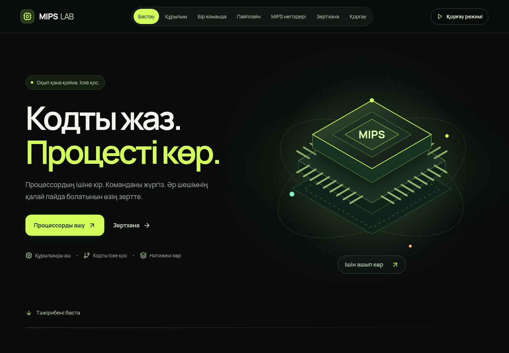

# MIPS LAB

Қазақша интерактивті оқу сайты: процессор құрылымынан MIPS ассемблеріндегі көп деңгейлі тармақталуға дейін.

**Автор:** Сейтқазы С.Қ.  
**СӨЖ тақырыбы:** «MIPS ассемблерінде шартты операторларды пайдаланып, көп деңгейлі тармақталуды жүзеге асыру».



## Іске қосу

Node.js 24 LTS ұсынылады (кемінде 22.12), npm. Сервер, API кілті және дерекқор қажет емес. Қаріптер пакетпен бірге беріледі; сайт сыртқы шрифт сервисіне тәуелді емес.

```sh
npm ci
npm run dev
```

Vite терминалда жергілікті адресті көрсетеді. Браузерде сол адресті ашыңыз.

```sh
npm test                 # интерпретатор, бес есеп және pipeline
npm run build            # TypeScript тексеруі + dist/ статикалық сайт
npm run preview          # дайын build-ті қарау
npm run test:browser     # Chromium арқылы негізгі оқу жолы
npm run test:pages       # алдын ала build керек: /soj1/ ішіндегі production smoke test
npm run format
```

Браузер тесттері әдепкіде `/usr/bin/chromium` қолданады. Басқа жүйеде:

```sh
npx playwright install chromium
CHROMIUM_PATH="$(node -e "process.stdout.write(require('playwright').chromium.executablePath())")" npm run test:browser
```

`test:pages` те `CHROMIUM_PATH` айнымалысын қолдайды. CI Chromium мен жүйелік кітапханаларын өзі орнатады. Тесттер `tests/` ішінде; browser trace нәтижелері `test-results/` ішінде жасалады.

## Оқу жолы

1. Процессор деген не? Анимацияланған чиптен ішкі құрылымға өту.
2. Құрылым: PC, командалар жады, басқару блогы, регистрлер, ALU, деректер жады және такт. Бөлікті тышқанмен немесе Tab + Enter арқылы таңдаңыз. Қайта жинау, ашу, үлкейту, шағын экранда көлденең жылжыту бар.
3. Бір команда: `add`, `lw`, `sw`, `beq`; IF → ID → EX → MEM → WB. Бастапқы операндтарды өзгертіңіз; кезеңдерді тікелей таңдауға да болады.
4. Пайплайн: тәуелсіз командалар, forwarding жоқ тәуелділіктер, ALU forwarding.
5. MIPS негіздері, шақыру келісімі, DEC/HEX/BIN.
6. Бес зертхана: үш сан; баға; бөліктік функция; мезгіл; калькулятор.
7. Қорғау: 11 аялдама, бес тапсырманың әрқайсысына өту, сөйлеуші мәтіні, үлкейтілген код пен регистрлер, браузер рұқсат етсе толық экран.

Бастау, кідірту, алға/артқа қадам, қайта бастау және жылдамдық басқарулары бар. Мән/код өзгерсе орындалу тарихы тазарады. Ойнату мәзірдің белсенді тармағына тәуелсіз. Тренажер экраннан толық кеткенде немесе браузер беті фонға ауысқанда уақытша кідіреді; қайта көрінгенде сол күйден жалғасады. `prefers-reduced-motion` қозғалыс эффектілерін өшіреді; кезеңдерді басқару сақталады.

## Жаңа көрініс

Сайт үлкен интерактивті сахналарға негізделген: кең оқылатын мәтіндер, көлемді процессор, команданың нақты мәндерін тасымалдау, пайплайн конвейері және бес бөлек анимациялық тәжірибе. Негізгі экрандарда ұсақ техникалық жазулар мен қайталанатын түсіндірмелер жоқ.

Зертханадағы **Код пен регистрлер** панелін ашсаңыз, бастапқы код, қадамдық белгілер, консоль, регистрлер мен шарттар журналы көрінеді. Көшіру, өңдеу және өз ASM файлыңызды ашу осы панельде; бес бағдарламаның архиві жоғарыда орналасқан. Есептеу ережелері мен оқу моделінің шектеулері төмендегі құжаттамада сақталған.

## Автоматты тәжірибе

- Зертханадағы **Есепті орындау** батырмасын бір рет басу жеткілікті: бағдарлама соңына дейін өзі орындалады. Код, процессор көрінісі, регистрлер, шарттар, консоль және график бір тарихпен жаңарады. Код терезесі ағымдағы жолға өзі жылжиды.
- Баға шектері, функция нүктелері және ай батырмалары мәнді таңдап қана қоймай, орындалуды автоматты қайта бастайды. Мәнді қолмен теру немесе кодты өңдеу ескі орындалуды тазартады; дайын болғанда қайта орындаңыз.
- Процессор көрінісі PC, команданы, регистрлерді, ALU/шартты және күй өзгерісін көрсетеді. Бұл аппараттық бес кезеңнің таймингін қайталамайды: source-level оқу көрінісі.
- График пен қорытынды нәтиже есептеу тармағы аяқталғанда көрінеді; бағдарлама консольге шығаруды жалғастыра алады. Баға есептеліп жатқанда ағымдағы әріп «кандидат» ретінде анық белгіленеді.
- Пайплайн сценарийін таңдау автоматты көрсетуді бастайды. Белсенді кезеңдер жоғарғы жолақта да көрсетіледі. Жад бөлімінде 42 мәні RAM → кэш → регистр → ALU жолымен кезекпен тасымалданады; барлық бөліктер бірден жанбайды.
- Барлық ойнатқышта кідірту, алға/артқа қадам, қайта бастау, 0.5×–8× жылдамдық және қосымша **Қайталау** бар. Жылдамдық есептеу нәтижесін өзгертпейді; қайталау бастапқы күйден басталады.
- **Қорғау маршрутын бастау** автоматты маршрутты қосады. Нұсқаушы панеліндегі **Авто көрсету / Кідірту** арқылы басқарыңыз. Команда, пайплайн және бес есеп өз орындалуын аяқтаған соң ғана келесі аялдамаға өтеді. Қолмен алдыңғы/келесі аялдаманы таңдау автоматты маршрутты тоқтатады.

## Зертханадағы бір ақиқат көзі

`src/model/mips.ts` кодты орындайды және өзгермейтін күй тарихын жасайды. Регистрлер, HI/LO, жад, консоль, енгізу индексі, шарт және PC сол тарихтан оқылады. Кері қадам толық бұрынғы күйді көрсетеді; тек визуалды кадрды ауыстырмайды. Тапсырма нәтижелері JS арқылы бөлек есептелмейді.

| Тапсырма | Енгізу реті                       | Нәтиже регистрлері                                                              |
| -------- | --------------------------------- | ------------------------------------------------------------------------------- |
| 1        | a, b, c                           | `$s0` max; `$s1` min; `$s2` тең жұп маскасы (ab=1, ac=2, bc=4); `$s3` a < b < c |
| 2        | баға                              | `$s0` ASCII әріп немесе −1                                                      |
| 3        | x                                 | `$s0` f(x); `$s1` тармақ 1/2/3                                                  |
| 4        | ай                                | `$s0` 1 қыс, 2 көктем, 3 жаз, 4 күз, −1 қате                                    |
| 5        | a, b, амал: 1 + / 2 − / 3 × / 4 ÷ | `$s0` нәтиже/бөлінді; `$s1` қалдық                                              |

Код редакторы және өз `.asm` файлын ашу бар. Өз бағдарламасында тапсырма визуалы жоғарыдағы регистр келісімін күтеді; жалпы нәтижені консоль, жад және регистрлерден қараңыз. Жеке жүктеу өңделген бағдарламаны, ZIP батырмасы бес бастапқы бағдарламаны береді.

## Оқу моделінің шектеулері

Бұл толық аппараттық эмулятор емес. Псевдокомандалар бастапқы код деңгейінде бір қадамда орындалады. Қадам саны аппараттық команда санына немесе нақты процессор тактіне тең емес. Код редакторындағы PC — `0x00400000 + source_instruction_index × 4` оқу адресі; псевдокомандалар MARS сияқты машиналық командаларға ашылмайды.

Қолдау: `li la move add addi addu addiu sub subu mul mult div mflo mfhi slt slti and andi or ori xor sll srl lw sw beq bne bge bgt ble blt bgez bltz j nop syscall`. Директивалар: `.data .text .globl .global .asciiz .word .space .align`. Syscall 1, 4, 5, 10, 11. Аргументтері бар көрсетілген синтаксис қана қолданылады; толық ассемблерлік өрнектер, символ арифметикасы және басқа директивалар жоқ.

- `$zero` өзгермейді. ADD/ADDI/SUB таңбалы overflow кезінде тоқтайды; ADDU/ADDIU/SUBU 32 битке оралады.
- MUL төменгі 32 битті сақтайды; жоғарғы мән жоғалса ескерту көрсетіледі. MULT HI/LO-ға толық 64 биттік көбейтінді жазады.
- DIV нөлге қарай қысқартады; қалдық таңбасы бөлінгішпен бірдей. Нөлге бөлу өңделеді. `INT_MIN / −1` үшін бұл оқу моделі LO = INT_MIN, HI = 0 деп көрсетіп, ескерту береді. Бұл шеткі жағдайға MIPS нұсқалары мен MARS арасында тасымалданатын кепілдік берілмейді.
- lw/sw тек 4 байтқа тураланған 64 КиБ деректер аймағын қолданады; инициализацияланбаған сөзді оқу диагностикаланады. Байттық жад, стекке lw/sw, FPU, exception handler және ОС жоқ.
- Кэш/RAM бөлімі — түсіндірме модель; интерпретатор кэшті, RAM кідірісін немесе нақты жиілікті модельдемейді.
- Зертхана қауіпсіздік шегі — 2000 source-level қадам. Ерекше үлкен x кезінде бөліктік функцияның арифметикасы да 32 битпен шектеледі.
- Pipeline: ретімен орындалатын бес кезең; WB бірінші жартысында жазады, ID екінші жартысында оқиды. Forwarding жоқ ALU тәуелділігіне 2 stall; келесі fetch қажет болғанша кешіктіріледі. ALU → ALU forwarding кезінде stall жоқ. Көрініс load-use мысалын орындамайды, оның бір stall керектігін мәтінмен түсіндіреді.
- Бір команданың кезеңдік анимациясы интерпретатордың операция алдындағы/кейінгі күйлерін тиісті кезеңдерге сәйкестендіреді. Физикалық шина таймингі мен pipeline регистрлері эмуляцияланбайды.

## MARS-пен тексеру

Экспорттар MARS 4.5-те тексерілді: **14 сценарий өтті**, соның ішінде бес тапсырма, тең сандар, 59/60/90/101 бағалары, x=0 және x=5, қате ай, 24/7 және −24/7, көбейту кезіндегі төменгі 32 бит, нөлге бөлу. Барлық мүмкін енгізулер MARS-та тексерілді деген мәлімдеме жасалмайды.

MARS-та **Settings → Delayed branching өшірулі** болсын. `.asm` файлын ашып, Assemble, содан кейін Go басыңыз. Әр syscall 5 үшін бір бүтін сан енгізіңіз. Консольдегі мәтін ASCII: MARS орталарымен үйлесімділік үшін; сайт интерфейсі қазақша.

Қайталанатын CLI тексеруі (Java қажет, MARS кәдімгі dev/build үшін қажет емес):

```sh
git clone https://github.com/dpetersanderson/MARS.git /tmp/mips-mars
git -C /tmp/mips-mars checkout ac3d34ea65c3b8349c4f6c00306bade9e3fec5c9
MARS_CLASSPATH=/tmp/mips-mars npm run test:mars
```

Ресми репозиторийдегі дайын Java кластарын қолданады. Өз JAR файлыңыз болса `MARS_CLASSPATH` соған нұсқай алады. Скрипт әр іске қосудың exit status-ін және күтілетін консоль нәтижесін тексереді; уақыт пен қадам шегі бар.

## GitHub Pages

`vite.config.ts` ішіндегі `base: './'`, hash-навигация және build-пен бірге берілетін қаріптер `/soj1/` жолында да жұмыс істейді. Архивтер браузерде жасалады, root-relative жүктеу жолдары жоқ.

1. Репозиторийде **Settings → Pages → Source → GitHub Actions** таңдаңыз.
2. **Actions → Deploy GitHub Pages → Run workflow** іске қосыңыз.
3. Workflow тексеріп, build жасап, `dist/` артефактісін жариялайды. Нақты сайт адресін GitHub береді.

`Check and build` workflow push/PR кезінде unit және browser тесттерін, TypeScript build және `/soj1/` production тексеруін орындайды. Deploy workflow `main` тармағына push кезінде автоматты іске қосылады; оны қолмен де іске қосуға болады. `configure-pages` сайтты автоматты қосып көреді; репозиторий саясаты тыйым салса, Settings → Pages баптауы қажет. Жергілікті build жасау өздігінен жариялау емес.

## Құрылым

```text
src/model/        MIPS интерпретаторы, pipeline кестесі, жүктеу
src/content/      Қазақша сабақтар, процессор бөліктері, MARS бағдарламалары
src/components/   Процессор SVG, сабақтар, кезеңдер, зертхана, басқару
src/App.tsx       Оқу жолы және қорғау маршруты
src/styles.css    Қара жасыл / лайм дизайн, responsive, reduced motion
scripts/          MARS және production Pages тексерулері
tests/            Unit және браузерлік тесттер
.github/workflows/ CI және Pages deployment
```

Бастапқы checkout бос болды: README, AGENTS.md, `docs/preview.jpg`, `dist/` немесе бұрынғы интерпретатор болған жоқ. Сондықтан жоба жаңадан құрылды; бұрынғы код не пайдаланушы файлдары өшірілген жоқ. `dist/` — тек build нәтижесі, бастапқы код `src/` ішінде.

## Дереккөздер

- [MARS](https://dpetersanderson.github.io/) және [ресми бастапқы код](https://github.com/dpetersanderson/MARS)
- [Syscall қызметтері](https://dpetersanderson.github.io/Help/SyscallHelp.html)
- [MARS баптаулары](https://dpetersanderson.github.io/Help/MarsHelpSettings.html)
- [Классикалық MIPS пайплайны, UCSB CS154](https://ucsb-cs154.github.io/w20/lectures/lect13.pdf)

Қаріптердің OFL лицензиялары `@fontsource` пакеттерінде, тәуелділіктердің лицензиялары олардың npm пакеттерінде беріледі.
